# Rapporto Benchmark Prestazionali - GreenBottle
**Data di Esecuzione:** 12 Novembre 2026  
**Ambiente di Riferimento:** JMH (Java Microbenchmark Harness) 1.37 — OpenJDK 64-Bit Server VM (JDK 21.0.13.0.2)  
**File Sorgente:** [benchmark_report.txt](file:///c:/Users/pasquale/Documents/GitHub/Peppe/GreenBottle/benchmark_report.txt)

---

## 1. Executive Summary

La suite di microbenchmark JMH di GreenBottle analizza le prestazioni computazionali di componenti critici dell'applicazione: gestione del carrello in sessione, validazione dei form, algoritmi crittografici, wrapper di conversione tra entità e viste, e soprattutto l'efficienza delle strutture dati in memoria (`HashSet`, `HashMap`) in relazione ai contratti `equals` e `hashCode`.

### Risultati Chiave & Scoperte Critiche:
1. **Degrado O(N²) in `ComposizioneHashSetBenchmark` (Criticità Alta)**:
   L'inserimento di righe d'ordine transienti (`id == null`) in un `HashSet` evidenzia un'esplosione quadratica. A 1.000 composizioni, il tempo passa da **18.07 µs** (con ID) a **1.602,14 µs** (transienti): **un degrado di quasi 90 volte (88.7x)** dovuto al 100% di collisioni hash (`hashCode() == 0`).
2. **Overhead di Lombok `@Data` in `ProdottoHashingBenchmark` (Criticità Media/Alta)**:
   La ricerca per chiave entità `Prodotto` in una `HashMap` richiede **55.04 - 55.78 ns**, contro i soli **2.77 - 2.79 ns** di una ricerca per chiave `Long id` (**rallentamento di circa 20x**). Lombok genera `equals` e `hashCode` su tutti i campi, inclusi l'array di byte dell'immagine (`byte[] img`) e l'oggetto ricorsivo `Categoria`.
3. **Problema Architetturale N+1 in `SessionCarrelloRealeBenchmark`**:
   La risoluzione del carrello di sessione in entità JPA scala linearmente in CPU (~39.6 µs per 1.000 righe). In un ambiente reale con database relazionale, le 1.000 chiamate singole `findById` rappresentano un classico anti-pattern **N+1 queries** che comporterebbe centinaia di millisecondi di latenza I/O.
4. **Eccellente Efficienza dei Moduli Accesso e Sessione**:
   - `SessionCarrello`: le operazioni atomiche di incremento e decremento impiegano **~15 ns** e **~25 ns**, indipendentemente dalla dimensione del carrello ($O(1)$).
   - `EncryptorUtil`: la crittografia e decrittografia AES impiegano tra **0.75 µs** e **1.25 µs** (costo trascurabile nel ciclo HTTP).
   - `RegistrazioneForm`: validazione Bean Validation in **4.65 - 5.97 µs**.

---

## 2. Configurazione e Metodologia di Misurazione

Tutti i test sono stati eseguiti con isolamento di processo e warm-up standard per stabilizzare il compilatore JIT C2:
- **JMH Version:** 1.37
- **Runtime:** OpenJDK 64-Bit Server VM, 21.0.13.0.2+1-LTS (Windows, x86_64)
- **Modalità Blackhole:** Compiler auto-detected
- **Campionamento:** 2 Fork distinti per ogni test, 5 iterazioni di warm-up (1s ciascuna), 5 iterazioni di misurazione (1s ciascuna), per un totale di 10 campioni misurati a regime.
- **Metrica:** `Mode.AverageTime` (Tempo medio per operazione espresso in microsecondi `µs/op` o nanosecondi `ns/op` a intervallo di confidenza al 99.9%).

---

## 3. Analisi Dettagliata per Benchmark

### 3.1. ComposizioneHashSetBenchmark
Misura il costo di costruzione dell'`HashSet<Composizione>` che raccoglie le righe di un ordine (come eseguito in `CreazioneOrdineController#post`).

| Dimensione ($N$) | Con ID valorizzato (`µs/op`) | Transienti / Senza ID (`µs/op`) | Delta / Rallentamento | Complessità |
| :--- | :--- | :--- | :--- | :--- |
| **N = 10** | 0.123 ± 0.002 µs | 0.253 ± 0.013 µs | +105% (2.05x) | $O(N)$ vs $O(N^2)$ |
| **N = 100** | 1.618 ± 0.147 µs | 19.001 ± 0.684 µs | +1.074% (**11.7x**) | $O(N)$ vs $O(N^2)$ |
| **N = 1.000** | 18.067 ± 3.911 µs | 1.602,135 ± 165.486 µs | +8.767% (**88.7x**) | $O(N)$ vs $O(N^2)$ |

#### Spiegazione Tecnica (Root Cause):
In `Composizione.java`:
```java
@Override
public int hashCode() {
  return id != null ? id.hashCode() : 0;
}
```
Quando le entità sono transienti (appena istanziate dal controller prima del salvataggio nel database), il campo `id` è `null`. Di conseguenza:
1. **Hash collision al 100%**: Tutti gli $N$ elementi restituiscono hash `0` e vengono confinati nell'unico bucket `table[0]` dell'`HashSet`.
2. **Confronti a catena**: Per inserire l'$i$-esimo elemento, `HashSet.add()` deve confrontare il nuovo oggetto con tutti gli $i-1$ elementi già inseriti mediante `equals()`. Poiché con `id == null` il metodo `equals()` restituisce sempre `false`, l'operazione non trova duplicati ma esegue $\sum_{i=1}^{N} (i-1) = \frac{N(N-1)}{2}$ invocazioni di `equals`.
3. Il costo degrada da lineare $O(N)$ a quadratico $O(N^2)$. A 1.000 righe l'operazione richiede oltre 1.6 millisecondi di tempo CPU puro.

---

### 3.2. ProdottoHashingBenchmark
Analizza l'impatto dell'annotazione Lombok `@Data` sulla classe `Prodotto`, utilizzata come chiave in `HashMap` nei wrapper (`OrdineWrapper`, `AbbonamentoWrapper`) e nei carrelli.

| Benchmark Operazione | Parametro `conCategoria` | Tempo Medio (`ns/op`) | Errore (99.9%) |
| :--- | :--- | :--- | :--- |
| **`lookupConChiaveId`** (Baseline) | `false` | **2.773 ns** | ± 0.049 ns |
| **`lookupConChiaveId`** (Baseline) | `true` | **2.790 ns** | ± 0.126 ns |
| **`lookupConChiaveProdotto`** | `false` | **55.044 ns** | ± 1.578 ns |
| **`lookupConChiaveProdotto`** | `true` | **55.784 ns** | ± 1.158 ns |
| **`hashCodeProdotto`** | `false` | **24.761 ns** | ± 2.500 ns |
| **`hashCodeProdotto`** | `true` | **24.782 ns** | ± 1.546 ns |
| **`equalsProdotti`** | `false` | **24.291 ns** | ± 2.029 ns |
| **`equalsProdotti`** | `true` | **46.616 ns** | ± 36.406 ns |

#### Spiegazione Tecnica (Root Cause):
- **Lookup 20x più lenta**: Effettuare una `map.get(prodotto)` costa **55.4 ns** contro i **2.78 ns** di `map.get(id)`.
- Lombok `@Data` genera `equals` e `hashCode` considerando **tutti i campi dell'oggetto**, compresi stringhe di descrizione e il payload `byte[] img` (tramite `Arrays.hashCode`).
- In `equalsProdotti`, la presenza della `Categoria` raddoppia il tempo di uguaglianza da **24.29 ns** a **46.62 ns** a causa della verifica ricorsiva dei campi dell'oggetto relazionato.

---

### 3.3. SessionCarrelloRealeBenchmark
Misura il metodo `SessionCarrello#getRealCarrello()`, che traduce gli ID dei prodotti conservati in sessione nelle rispettive entità `Prodotto`. Il test utilizza un DAO fittizio in-memory (proxy dinamico) per isolare la complessità computazionale dalla latenza di rete/DB.

| Prodotti nel Carrello ($N$) | Catalogo Presente (%) | Tempo Medio (`µs/op`) | Errore (99.9%) |
| :--- | :--- | :--- | :--- |
| **N = 10** | 100% | 0.223 µs | ± 0.008 µs |
| **N = 100** | 100% | 2.937 µs | ± 0.092 µs |
| **N = 1.000** | 100% | 39.620 µs | ± 2.292 µs |
| **N = 10** | 50% | 0.217 µs | ± 0.015 µs |
| **N = 100** | 50% | 1.798 µs | ± 0.101 µs |
| **N = 1.000** | 50% | 19.704 µs | ± 0.548 µs |

#### Spiegazione Tecnica:
- La crescita temporale in memoria è perfettamente lineare $O(N)$ (~39.6 ns per prodotto trovato).
- Con solo il 50% di prodotti presenti nel catalogo, il tempo a 1.000 elementi si dimezza a 19.7 µs perché i prodotti assenti evitano l'inserimento e la gestione dell'entità nella mappa risultante.
- **Rilevanza Architetturale (N+1 Queries)**: questo valore è un *lower bound* ottimistico. Nel sistema reale in produzione, ogni iterazione del ciclo invoca `prodottoDao.findById(id)` sul database PostgreSQL. Con 50 prodotti nel carrello, vengono inviate 50 query SQL sequenziali anziché una singola query batch `findAllById(ids)`.

---

### 3.4. SessionCarrelloBenchmark
Misura la reattività delle strutture dati del carrello di sessione in memoria.

| Metodo | Dimensione Iniziale | Tempo Medio (`ns/op`) | Errore (99.9%) |
| :--- | :--- | :--- | :--- |
| **`addToCarrelloProdottoEsistente`** | 1 prodotto | 15.039 ns | ± 0.110 ns |
| **`addToCarrelloProdottoEsistente`** | 10 prodotti | 15.357 ns | ± 0.495 ns |
| **`addToCarrelloProdottoEsistente`** | 100 prodotti | 15.566 ns | ± 1.012 ns |
| **`removeFromCarrello`** | 1 prodotto | 25.589 ns | ± 0.880 ns |
| **`removeFromCarrello`** | 10 prodotti | 25.354 ns | ± 0.612 ns |
| **`removeFromCarrello`** | 100 prodotti | 26.867 ns | ± 5.187 ns |
| **`clearCarrello`** | 1 prodotto | 27.765 ns | ± 0.372 ns |
| **`clearCarrello`** | 10 prodotti | 27.990 ns | ± 0.622 ns |
| **`clearCarrello`** | 100 prodotti | 90.244 ns | ± 4.003 ns |

#### Spiegazione Tecnica:
- Sia l'inserimento/aggiornamento che la cancellazione mostrano complessità costante $O(1)$ (~15 ns per add, ~25 ns per remove).
- La pulizia totale `clearCarrello()` passa da 27.8 ns a 90.2 ns a 100 elementi, riflettendo il reset interno dell'array di bucket della `HashMap` Java.

---

### 3.5. WrapperBenchmark
Misura la conversione in mappa `Prodotto -> Quantità` effettuata dai wrapper delle viste:
- `OrdineWrapper#getProdottiOrdine()`
- `AbbonamentoWrapper#getProdottiAbbonamento()`

| Dimensione ($N$) | `getProdottiOrdine` (`µs/op`) | `getProdottiAbbonamento` (`µs/op`) |
| :--- | :--- | :--- |
| **N = 10** | 0.189 ± 0.005 µs | 0.179 ± 0.016 µs |
| **N = 100** | 2.517 ± 0.032 µs | 2.593 ± 0.124 µs |
| **N = 1.000** | 32.591 ± 1.207 µs | 34.224 ± 0.950 µs |

#### Spiegazione Tecnica:
- Comportamento perfettamente simmetrico e lineare (~33 ns per riga).
- Ciascuna riga esegue un hashing dell'entità `Prodotto`. I tempi sono perfettamente in linea con i ~25 ns di `hashCodeProdotto` misurati in `ProdottoHashingBenchmark`.

---

### 3.6. EncryptorUtilBenchmark
Misura i tempi della cifratura/decifratura simmetrica AES-128 con codifica Base64.

| Lunghezza Testo | Cifratura (`encrypt`) | Decifratura (`decrypt`) |
| :--- | :--- | :--- |
| **8 caratteri** | 0.757 ± 0.036 µs | 0.801 ± 0.033 µs |
| **64 caratteri** | 0.781 ± 0.006 µs | 0.848 ± 0.029 µs |
| **512 caratteri** | 1.252 ± 0.238 µs | 1.238 ± 0.167 µs |

#### Spiegazione Tecnica:
- Tempi sub-microsecondo per testi tipici (password, token, email cifrate).
- Le routine crittografiche beneficiano dell'accelerazione hardware AES-NI della CPU, rendendo l'impatto prestazionale impercettibile (< 0.001 ms).

---

### 3.7. RegistrazioneFormBenchmark
Misura l'esecuzione dei vincoli Jakarta / Hibernate Bean Validation (email regex, password policy, lunghezze campi, controlli di non-nullità).

| Caso di Test | Tempo Medio (`µs/op`) | Errore (99.9%) |
| :--- | :--- | :--- |
| **`validateFormValido`** | **5.967 µs** | ± 0.229 µs |
| **`validateFormNonValido`** | **4.650 µs** | ± 0.157 µs |

#### Spiegazione Tecnica:
- La validazione richiede meno di 6 microsecondi per form.
- Il form non valido termina prima (~4.65 µs vs ~5.97 µs) poiché le violazioni sulle lunghezze minime e stringhe vuote falliscono tempestivamente, evitando valutazioni regex più approfondite (ad es. per password complesse).

---

## 4. Tabella Riassuntiva Completa

| Benchmark | Parametri | Mode | Score | Errore | Unità |
| :--- | :--- | :--- | :--- | :--- | :--- |
| `ComposizioneHashSet.inserisciConId` | N=10 | avgt | 0.123 | ± 0.002 | µs/op |
| `ComposizioneHashSet.inserisciConId` | N=100 | avgt | 1.618 | ± 0.147 | µs/op |
| `ComposizioneHashSet.inserisciConId` | N=1000 | avgt | 18.067 | ± 3.911 | µs/op |
| `ComposizioneHashSet.inserisciTransienti` | N=10 | avgt | 0.253 | ± 0.013 | µs/op |
| `ComposizioneHashSet.inserisciTransienti` | N=100 | avgt | 19.001 | ± 0.684 | µs/op |
| `ComposizioneHashSet.inserisciTransienti` | N=1000 | avgt | 1602.135 | ± 165.486 | µs/op |
| `ProdottoHashing.lookupConChiaveId` | conCat=false | avgt | 2.773 | ± 0.049 | ns/op |
| `ProdottoHashing.lookupConChiaveId` | conCat=true | avgt | 2.790 | ± 0.126 | ns/op |
| `ProdottoHashing.lookupConChiaveProdotto` | conCat=false | avgt | 55.044 | ± 1.578 | ns/op |
| `ProdottoHashing.lookupConChiaveProdotto` | conCat=true | avgt | 55.784 | ± 1.158 | ns/op |
| `ProdottoHashing.hashCodeProdotto` | conCat=false | avgt | 24.761 | ± 2.500 | ns/op |
| `ProdottoHashing.hashCodeProdotto` | conCat=true | avgt | 24.782 | ± 1.546 | ns/op |
| `ProdottoHashing.equalsProdotti` | conCat=false | avgt | 24.291 | ± 2.029 | ns/op |
| `ProdottoHashing.equalsProdotti` | conCat=true | avgt | 46.616 | ± 36.406 | ns/op |
| `SessionCarrello.addToCarrelloProdottoEsistente` | N=1 | avgt | 15.039 | ± 0.110 | ns/op |
| `SessionCarrello.addToCarrelloProdottoEsistente` | N=10 | avgt | 15.357 | ± 0.495 | ns/op |
| `SessionCarrello.addToCarrelloProdottoEsistente` | N=100 | avgt | 15.566 | ± 1.012 | ns/op |
| `SessionCarrello.removeFromCarrello` | N=1 | avgt | 25.589 | ± 0.880 | ns/op |
| `SessionCarrello.removeFromCarrello` | N=10 | avgt | 25.354 | ± 0.612 | ns/op |
| `SessionCarrello.removeFromCarrello` | N=100 | avgt | 26.867 | ± 5.187 | ns/op |
| `SessionCarrello.clearCarrello` | N=1 | avgt | 27.765 | ± 0.372 | ns/op |
| `SessionCarrello.clearCarrello` | N=10 | avgt | 27.990 | ± 0.622 | ns/op |
| `SessionCarrello.clearCarrello` | N=100 | avgt | 90.244 | ± 4.003 | ns/op |
| `SessionCarrelloReale.getRealCarrello` | 100%, N=10 | avgt | 0.223 | ± 0.008 | µs/op |
| `SessionCarrelloReale.getRealCarrello` | 100%, N=100 | avgt | 2.937 | ± 0.092 | µs/op |
| `SessionCarrelloReale.getRealCarrello` | 100%, N=1000 | avgt | 39.620 | ± 2.292 | µs/op |
| `SessionCarrelloReale.getRealCarrello` | 50%, N=10 | avgt | 0.217 | ± 0.015 | µs/op |
| `SessionCarrelloReale.getRealCarrello` | 50%, N=100 | avgt | 1.798 | ± 0.101 | µs/op |
| `SessionCarrelloReale.getRealCarrello` | 50%, N=1000 | avgt | 19.704 | ± 0.548 | µs/op |
| `Wrapper.getProdottiOrdine` | N=10 | avgt | 0.189 | ± 0.005 | µs/op |
| `Wrapper.getProdottiOrdine` | N=100 | avgt | 2.517 | ± 0.032 | µs/op |
| `Wrapper.getProdottiOrdine` | N=1000 | avgt | 32.591 | ± 1.207 | µs/op |
| `Wrapper.getProdottiAbbonamento` | N=10 | avgt | 0.179 | ± 0.016 | µs/op |
| `Wrapper.getProdottiAbbonamento` | N=100 | avgt | 2.593 | ± 0.124 | µs/op |
| `Wrapper.getProdottiAbbonamento` | N=1000 | avgt | 34.224 | ± 0.950 | µs/op |
| `EncryptorUtil.encrypt` | len=8 | avgt | 0.757 | ± 0.036 | µs/op |
| `EncryptorUtil.encrypt` | len=64 | avgt | 0.781 | ± 0.006 | µs/op |
| `EncryptorUtil.encrypt` | len=512 | avgt | 1.252 | ± 0.238 | µs/op |
| `EncryptorUtil.decrypt` | len=8 | avgt | 0.801 | ± 0.033 | µs/op |
| `EncryptorUtil.decrypt` | len=64 | avgt | 0.848 | ± 0.029 | µs/op |
| `EncryptorUtil.decrypt` | len=512 | avgt | 1.238 | ± 0.167 | µs/op |
| `RegistrazioneForm.validateFormNonValido` | default | avgt | 4.650 | ± 0.157 | µs/op |
| `RegistrazioneForm.validateFormValido` | default | avgt | 5.967 | ± 0.229 | µs/op |

---

## 5. Grafico Comparativo: Il Collo di Bottiglia O(N²)

La progressione di `ComposizioneHashSetBenchmark` evidenzia la divergenza tra andamento lineare $O(N)$ e andamento quadratico $O(N^2)$:

```mermaid
xychart-beta
    title "Tempo di Esecuzione (µs) al variare di N [Scala Lineare]"
    x-axis ["N = 10", "N = 100", "N = 1000"]
    y-axis "Tempo (µs)" 0 --> 1700
    bar [0.12, 1.62, 18.07]
    bar [0.25, 19.00, 1602.14]
```



*(Nel grafico: la prima serie rappresenta le composizioni con ID valorizzato $O(N)$, la seconda serie le composizioni transienti $O(N^2)$).*

---

## 6. Raccomandazioni e Piano d'Azione

| Priorità | Area / Componente | Problema Identificato | Soluzione Raccomandata |
| :--- | :--- | :--- | :--- |
| **P1 - Alta** | `CreazioneOrdineController` e `Composizione` | Inserimento di entità con `id == null` in un `HashSet` causa collisioni totali e tempo $O(N^2)$. | 1. In `CreazioneOrdineController#post`, utilizzare una `List<Composizione>` o `LinkedHashSet` senza fare affidamento su `hashCode()` prima del persist.<br>2. Definire `equals` e `hashCode` su `Composizione` basandosi sulla business key (es. `prodotto` + `ordine`) o escludere `hashCode()` transiente da `0`. |
| **P2 - Media** | `SessionCarrello#getRealCarrello` | Iterazione con chiamate singole `findById` (potenziale problema N+1 su database). | Sostituire il ciclo di `findById` con una chiamata batch `prodottoDao.findAllById(carrello.keySet())` e rimappare i risultati. Questo riduce $N$ query di rete a 1 singola query SQL `WHERE id IN (...)`. |
| **P3 - Media** | `Prodotto` (Lombok `@Data`) | Lookup per entità 20x più lente rispetto all'ID (`55 ns` vs `2.8 ns`) per via dell'hashing su stringhe e array `byte[] img`. | 1. Inserire `@EqualsAndHashCode(onlyExplicitlyIncluded = true)` su `Prodotto` ed includere solo `@EqualsAndHashCode.Include private Long id;`.<br>2. Nei wrapper e mappe intermedie, utilizzare preferibilmente `Map<Long, Integer>` indicizzata per ID se non è strettamente necessaria l'intera istanza come chiave. |
| **P4 - Bassa** | `EncryptorUtil` e `RegistrazioneForm` | Performance già ottimali (< 1.3 µs e < 6 µs). | Nessun intervento correttivo necessario. Mantenere l'attuale implementazione. |
