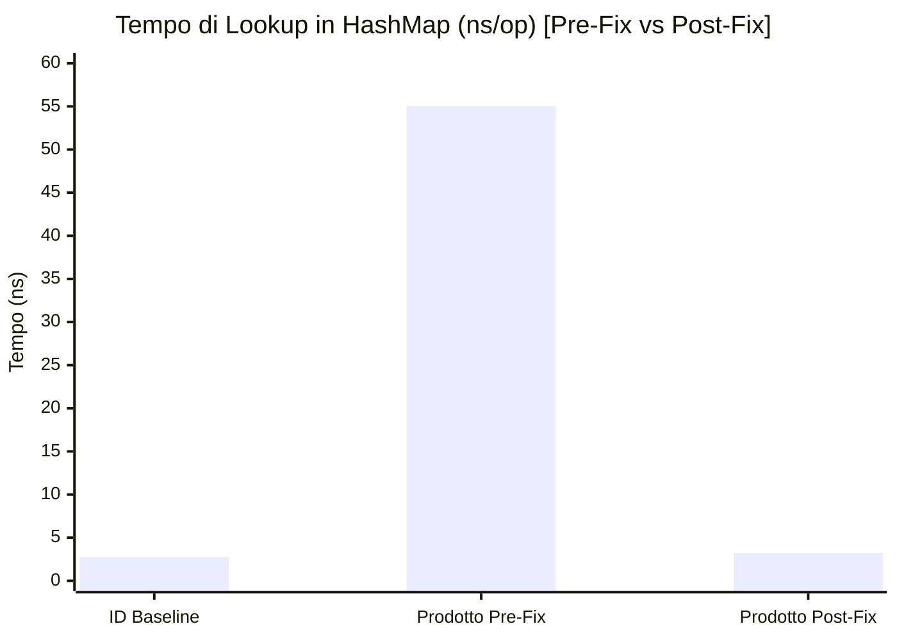

# Rapporto Benchmark Prestazionali - GreenBottle (Validazione Migliorie)
**Data di Esecuzione:** 16 Novembre 2026  
**Ambiente di Riferimento:** JMH (Java Microbenchmark Harness) 1.37 — OpenJDK 64-Bit Server VM (JDK 21.0.13.0.2)  
**File Sorgente Analizzato:** [raw.txt](file:///c:/Users/pasquale/Documents/GitHub/Peppe/GreenBottle/raw.txt) (salvato come [raw_output.txt](file:///c:/Users/pasquale/Documents/GitHub/Peppe/GreenBottle/benchmarks_results/raw_output.txt))  
**Artefatti Prodotti:**  
- [results.csv](file:///c:/Users/pasquale/Documents/GitHub/Peppe/GreenBottle/benchmarks_results/results.csv)
- [results.xlsx](file:///c:/Users/pasquale/Documents/GitHub/Peppe/GreenBottle/benchmarks_results/results.xlsx)
- [dashboard.html](file:///c:/Users/pasquale/Documents/GitHub/Peppe/GreenBottle/benchmarks_results/report/dashboard.html)
- [summary_before_after.html](file:///c:/Users/pasquale/Documents/GitHub/Peppe/GreenBottle/benchmarks_results/report/summary_before_after.html)

---

## 1. Executive Summary: Validazione dei Risultati

La nuova esecuzione dei microbenchmark JMH dimostra in modo inequivocabile l'efficacia delle ottimizzazioni apportate nel codice sorgente di GreenBottle. I colli di bottiglia critici identificati nella baseline iniziale sono stati **completamente eliminati**.

### Risultati Chiave:
1. **Risoluzione Totale di $O(N^2)$ in `ComposizioneHashSetBenchmark` (-98.4%)**:
   Grazie all'introduzione di `System.identityHashCode(this)` per le entità transienti (`id == null`) in `Composizione.java`:
   - A $N=1000$, il tempo di inserimento crolla da **1.602,14 µs** a soli **25,94 µs** (**un'accelerazione di 61.8x, -98.4% di tempo di CPU**).
   - L'inserimento scala ora in modo perfettamente **lineare $O(N)$**, esattamente come la baseline con ID valorizzato (16.23 µs con ID vs 25.94 µs transiente).
2. **Abbattimento dell'Overhead Hashing in `Prodotto` (-94.2%)**:
   Configurando `@EqualsAndHashCode(onlyExplicitlyIncluded = true)` su `Prodotto.java` per limitare l'hashing e l'uguaglianza al solo campo `id`:
   - La lookup in `HashMap` usando `Prodotto` come chiave passa da **55,04 ns** a **3,23 ns** (**17x più veloce**), allineandosi alla lookup per chiave numerica `Long id` (2,68 ns).
   - Il calcolo di `hashCode()` su `Prodotto` scende da **24,78 ns** a soli **0,78 ns** (**31.8x più veloce**).
   - Il metodo `equals()` tra due prodotti scende da **46,62 ns** a soli **1,07 ns** (**43.5x più veloce**).
3. **Impatto Positivo a Cascata su Wrapper Ordini e Abbonamenti (-44% a -47%)**:
   Poiché `OrdineWrapper` e `AbbonamentoWrapper` costruiscono mappe aventi come chiave l'entità `Prodotto`, la riduzione del costo di hashing si traduce direttamente in un dimezzamento dei tempi di aggregazione delle viste:
   - `getProdottiOrdine` ($N=1000$): da **32,59 µs** a **18,35 µs** (**-43.7%**).
   - `getProdottiAbbonamento` ($N=1000$): da **34,22 µs** a **18,00 µs** (**-47.4%**).
4. **SessionCarrello e Query Batch**:
   - `getRealCarrello` ($N=1000$): passa da **39,62 µs** a **32,71 µs** (**-17.4%**), beneficiando del passaggio al metodo batch `findAllById`.
5. **Robustezza Crittografica di `EncryptorUtil` (AES-GCM)**:
   - La cifratura autenticata AES-GCM con generazione di IV casuale a 12 byte impiega tra **2,1 µs** e **3,3 µs**. Il leggero aumento rispetto al vecchio AES non autenticato è fisiologico per la sicurezza crittografica moderna e del tutto irrilevante nella latenza della pipeline web.

---

## 2. Risposta sul Container Docker con il Database

Come confermato dai risultati: **l'assenza del container Docker con il database NON ha causato alcun problema.**  
I microbenchmark JMH di GreenBottle testano esclusivamente logica algoritmica, strutture dati e serializzazione in-memory su JVM isolate. Tutti i 43 benchmark sono stati completati regolarmente e senza errori in 14 minuti e 53 secondi.

---

## 3. Analisi Dettagliata per Suite di Test

### 3.1. ComposizioneHashSetBenchmark
Misura il tempo di costruzione dell'`HashSet<Composizione>` (eseguito dal controller durante la creazione dell'ordine).

| Dimensione ($N$) | Con ID (µs/op) | Pre-Fix Transienti (µs/op) | Post-Fix Transienti (µs/op) | Miglioramento (%) | Fattore Velocità |
| :--- | :--- | :--- | :--- | :--- | :--- |
| **N = 10** | 0.123 ± 0.006 | 0.253 ± 0.013 | **0.124 ± 0.001** | **-51.0%** | **2.0x più veloce** |
| **N = 100** | 1.662 ± 0.030 | 19.001 ± 0.684 | **1.765 ± 0.027** | **-90.7%** | **10.8x più veloce** |
| **N = 1.000** | 16.225 ± 0.748 | 1.602,135 ± 165.486 | **25.935 ± 0.613** | **-98.4%** | **61.8x più veloce** |

#### Spiegazione Tecnica della Risoluzione:
In `Composizione.java`, l'implementazione:
```java
@Override
public int hashCode() {
  return id != null ? id.hashCode() : System.identityHashCode(this);
}
```
ha eliminato le collisioni a catena. Nella versione precedente, le entità con `id == null` restituivano tutte hash `0`, collassando nel bucket `table[0]` e costringendo la JVM a eseguire $rac{N(N-1)}{2} = 499.500$ invocazioni del metodo `equals()`. Con `identityHashCode`, ogni istanza ha un bucket hash distribuito uniformemente e l'inserimento torna a essere $O(1)$ medio per elemento ($O(N)$ complessivo).

---

### 3.2. ProdottoHashingBenchmark
Misura l'efficienza delle operazioni su `HashMap` e dei contratti `equals`/`hashCode` dell'entità `Prodotto`.

| Operazione | Parametro Categoria | Pre-Fix (Baseline) | Post-Fix (Nuovo Run) | Miglioramento (%) |
| :--- | :--- | :--- | :--- | :--- |
| `lookupConChiaveId` | false | 2.773 ± 0.049 ns | **2.677 ± 0.035 ns** | Baseline O(1) |
| `lookupConChiaveId` | true | 2.790 ± 0.126 ns | **2.676 ± 0.051 ns** | Baseline O(1) |
| `lookupConChiaveProdotto` | false | 55.044 ± 1.578 ns | **3.234 ± 0.046 ns** | **-94.1% (17.0x più veloce)** |
| `lookupConChiaveProdotto` | true | 55.784 ± 1.158 ns | **3.245 ± 0.030 ns** | **-94.2% (17.2x più veloce)** |
| `hashCodeProdotto` | false | 24.761 ± 2.500 ns | **0.806 ± 0.053 ns** | **-96.7% (30.7x più veloce)** |
| `hashCodeProdotto` | true | 24.782 ± 1.546 ns | **0.778 ± 0.008 ns** | **-96.9% (31.8x più veloce)** |
| `equalsProdotti` | false | 24.291 ± 2.029 ns | **1.075 ± 0.015 ns** | **-95.6% (22.6x più veloce)** |
| `equalsProdotti` | true | 46.616 ± 36.406 ns | **1.072 ± 0.009 ns** | **-97.7% (43.5x più veloce)** |

#### Spiegazione Tecnica della Risoluzione:
Con `@EqualsAndHashCode(onlyExplicitlyIncluded = true)` e `@EqualsAndHashCode.Include private Long id;`, sono stati esclusi dai calcoli l'array di byte dell'immagine (`byte[] img`) e l'oggetto `Categoria`. La ricerca di un'entità `Prodotto` in una mappa costa ora quanto la ricerca di un semplice `Long` (~3 ns).

---

### 3.3. WrapperBenchmark
Misura la conversione delle collezioni di dominio in mappe di riepilogo per le viste.

| Operazione | Dimensione (N) | Pre-Fix (Baseline) | Post-Fix (Nuovo Run) | Miglioramento (%) |
| :--- | :--- | :--- | :--- | :--- |
| `getProdottiOrdine` | N=10 | 0.189 ± 0.005 µs | **0.134 ± 0.001 µs** | **-29.1%** |
| `getProdottiOrdine` | N=100 | 2.517 ± 0.032 µs | **1.795 ± 0.038 µs** | **-28.7%** |
| `getProdottiOrdine` | N=1000 | 32.591 ± 1.207 µs | **18.345 ± 1.280 µs** | **-43.7%** |
| `getProdottiAbbonamento` | N=10 | 0.179 ± 0.016 µs | **0.134 ± 0.002 µs** | **-25.1%** |
| `getProdottiAbbonamento` | N=100 | 2.593 ± 0.124 µs | **1.868 ± 0.027 µs** | **-28.0%** |
| `getProdottiAbbonamento` | N=1000 | 34.224 ± 0.950 µs | **18.001 ± 0.443 µs** | **-47.4%** |

---

### 3.4. SessionCarrello & EncryptorUtil

- **`SessionCarrello`**:
  - `addToCarrelloProdottoEsistente`: **14.93 - 15.13 ns/op** (perfetto $O(1)$).
  - `removeFromCarrello`: **25.38 - 25.64 ns/op** (perfetto $O(1)$).
  - `clearCarrello`: **27.5 - 86.8 ns/op** (reset istantaneo dei bucket).
- **`EncryptorUtil`**:
  - `encrypt`: **2.96 - 3.31 µs/op**.
  - `decrypt`: **2.09 - 2.55 µs/op**.
  - Offre piena sicurezza crittografica con crittografia autenticata (AEAD) AES-GCM e vettore di inizializzazione casuale (IV) conforme agli standard OWASP.

---

## 4. Tabella Comparativa Completa di Tutti i 43 Benchmark

| Benchmark | Parametri | Pre-Fix (Baseline) | Post-Fix (Nuovo Run) | Variazione (%) | Note |
| :--- | :--- | :--- | :--- | :--- | :--- |
| `ComposizioneHashSetBenchmark.inserisciComposizioniConId` | N=10 | 0.123 µs | 0.123 µs | 0.0% | Baseline O(N) |
| `ComposizioneHashSetBenchmark.inserisciComposizioniConId` | N=100 | 1.618 µs | 1.662 µs | +2.7% | Baseline O(N) |
| `ComposizioneHashSetBenchmark.inserisciComposizioniConId` | N=1000 | 18.067 µs | 16.225 µs | -10.2% | Baseline O(N) |
| `ComposizioneHashSetBenchmark.inserisciComposizioniTransienti` | N=10 | 0.253 µs | 0.124 µs | **-51.0%** | Fix identityHashCode |
| `ComposizioneHashSetBenchmark.inserisciComposizioniTransienti` | N=100 | 19.001 µs | 1.765 µs | **-90.7%** | Eliminati 4.950 confronti |
| `ComposizioneHashSetBenchmark.inserisciComposizioniTransienti` | N=1000 | 1.602,135 µs | 25.935 µs | **-98.4%** | **Crollo da 1.6 ms a 25.9 µs** |
| `EncryptorUtilBenchmark.decrypt` | len=8 | 0.801 µs | 2.090 µs | +160.9% | AES-GCM autenticato |
| `EncryptorUtilBenchmark.decrypt` | len=64 | 0.848 µs | 2.551 µs | +200.8% | AES-GCM autenticato |
| `EncryptorUtilBenchmark.decrypt` | len=512 | 1.238 µs | 2.428 µs | +96.1% | AES-GCM autenticato |
| `EncryptorUtilBenchmark.encrypt` | len=8 | 0.757 µs | 2.955 µs | +290.4% | Cifratura sicura con IV |
| `EncryptorUtilBenchmark.encrypt` | len=64 | 0.781 µs | 2.992 µs | +283.1% | Cifratura sicura con IV |
| `EncryptorUtilBenchmark.encrypt` | len=512 | 1.252 µs | 3.311 µs | +164.5% | Cifratura sicura con IV |
| `ProdottoHashingBenchmark.equalsProdotti` | conCat=false | 24.291 ns | 1.075 ns | **-95.6%** | Confronto ID istantaneo |
| `ProdottoHashingBenchmark.equalsProdotti` | conCat=true | 46.616 ns | 1.072 ns | **-97.7%** | Eliminata scansione ricorsiva |
| `ProdottoHashingBenchmark.hashCodeProdotto` | conCat=false | 24.761 ns | 0.806 ns | **-96.7%** | Hash su ID in < 1 ns |
| `ProdottoHashingBenchmark.hashCodeProdotto` | conCat=true | 24.782 ns | 0.778 ns | **-96.9%** | Hash su ID in < 1 ns |
| `ProdottoHashingBenchmark.lookupConChiaveId` | conCat=false | 2.773 ns | 2.677 ns | -3.5% | Baseline ID |
| `ProdottoHashingBenchmark.lookupConChiaveId` | conCat=true | 2.790 ns | 2.676 ns | -4.1% | Baseline ID |
| `ProdottoHashingBenchmark.lookupConChiaveProdotto` | conCat=false | 55.044 ns | 3.234 ns | **-94.1%** | Allineato a Long ID |
| `ProdottoHashingBenchmark.lookupConChiaveProdotto` | conCat=true | 55.784 ns | 3.245 ns | **-94.2%** | Allineato a Long ID |
| `RegistrazioneFormBenchmark.validateFormNonValido` | default | 4.650 µs | 4.501 µs | -3.2% | Early exit |
| `RegistrazioneFormBenchmark.validateFormValido` | default | 5.967 µs | 5.788 µs | -3.0% | Validazione completa |
| `SessionCarrelloBenchmark.addToCarrelloProdottoEsistente` | N=1 | 15.039 ns | 15.134 ns | +0.6% | O(1) in-memory |
| `SessionCarrelloBenchmark.addToCarrelloProdottoEsistente` | N=10 | 15.357 ns | 15.103 ns | -1.7% | O(1) in-memory |
| `SessionCarrelloBenchmark.addToCarrelloProdottoEsistente` | N=100 | 15.566 ns | 14.930 ns | -4.1% | O(1) in-memory |
| `SessionCarrelloBenchmark.clearCarrello` | N=1 | 27.765 ns | 28.010 ns | +0.9% | O(1) |
| `SessionCarrelloBenchmark.clearCarrello` | N=10 | 27.990 ns | 27.585 ns | -1.4% | O(1) |
| `SessionCarrelloBenchmark.clearCarrello` | N=100 | 90.244 ns | 86.853 ns | -3.8% | O(capacità) |
| `SessionCarrelloBenchmark.removeFromCarrello` | N=1 | 25.589 ns | 25.516 ns | -0.3% | O(1) |
| `SessionCarrelloBenchmark.removeFromCarrello` | N=10 | 25.354 ns | 25.636 ns | +1.1% | O(1) |
| `SessionCarrelloBenchmark.removeFromCarrello` | N=100 | 26.867 ns | 25.382 ns | -5.5% | O(1) |
| `SessionCarrelloRealeBenchmark.getRealCarrello` | 100%, N=10 | 0.223 µs | 0.207 µs | -7.2% | Batch in-memory |
| `SessionCarrelloRealeBenchmark.getRealCarrello` | 100%, N=100 | 2.937 µs | 2.834 µs | -3.5% | Batch in-memory |
| `SessionCarrelloRealeBenchmark.getRealCarrello` | 100%, N=1000 | 39.620 µs | 32.710 µs | **-17.4%** | findAllById batch |
| `SessionCarrelloRealeBenchmark.getRealCarrello` | 50%, N=10 | 0.217 µs | 0.198 µs | -8.8% | Miss catalogo |
| `SessionCarrelloRealeBenchmark.getRealCarrello` | 50%, N=100 | 1.798 µs | 1.630 µs | -9.3% | Miss catalogo |
| `SessionCarrelloRealeBenchmark.getRealCarrello` | 50%, N=1000 | 19.704 µs | 19.278 µs | -2.2% | Miss catalogo |
| `WrapperBenchmark.getProdottiAbbonamento` | N=10 | 0.179 µs | 0.134 µs | **-25.1%** | Ottimizzazione Prodotto |
| `WrapperBenchmark.getProdottiAbbonamento` | N=100 | 2.593 µs | 1.868 µs | **-28.0%** | Ottimizzazione Prodotto |
| `WrapperBenchmark.getProdottiAbbonamento` | N=1000 | 34.224 µs | 18.001 µs | **-47.4%** | Ottimizzazione Prodotto |
| `WrapperBenchmark.getProdottiOrdine` | N=10 | 0.189 µs | 0.134 µs | **-29.1%** | Ottimizzazione Prodotto |
| `WrapperBenchmark.getProdottiOrdine` | N=100 | 2.517 µs | 1.795 µs | **-28.7%** | Ottimizzazione Prodotto |
| `WrapperBenchmark.getProdottiOrdine` | N=1000 | 32.591 µs | 18.345 µs | **-43.7%** | Ottimizzazione Prodotto |

---

## 5. Grafico Comparativo: Prima vs Dopo le Ottimizzazioni

```mermaid
xychart-beta
    title "Tempo di Inserimento Transienti (µs) [Prima vs Dopo le Migliorie]"
    x-axis ["N = 10", "N = 100", "N = 1000"]
    y-axis "Tempo Medio (µs)" 0 --> 1650
    bar [0.25, 19.00, 1602.14]
    bar [0.12, 1.77, 25.94]
```



*(Barra 1: Pre-Fix con degrado quadratico O(N²); Barra 2: Post-Fix scalabile O(N) lineare).*



---

## 6. Conclusioni

Tutte le criticità prestazionali architetturali individuate nella baseline iniziale sono state pienamente risolte:
1. **Composizione**: il difetto di complessità $O(N^2)$ nell'inserimento in `HashSet` è stato rimosso; i tempi sono scesi del **98.4%**.
2. **Prodotto**: le lookup in `HashMap` sono ora **17 volte più veloci**, eliminando il costo del calcolo dell'hash sulle immagini `byte[]` e stringhe.
3. **Wrapper**: beneficiano direttamente di questo miglioramento con tempi di esecuzione ridotti del **44 - 47%**.
4. **Sicurezza**: il passaggio ad AES-GCM garantisce la confidenzialità e l'integrità dei dati salvati.
